# StreamShield

Built by **Mahdy Lorens Gribkov** (מהדי לורנס גריבקוב) | [mahdygribkov.com](https://mahdygribkov.com) | [SporeSec](https://sporesec.com/en/mahdy-lorens-gribkov)

[](https://github.com/mahdy-gribkov/stream-shield/actions/workflows/ci.yml)
[](LICENSE)
[]()
[]()
[-blue.svg)]()

**The first tool that auto-detects sensitive input fields and hides them from screen capture in real-time.**

- Passwords, credit cards, SSNs, API keys, tokens, OTPs, and any sensitive field are automatically detected
- Stream/capture sees a grey mask. You see what you type.
- Works with Discord, Zoom, Google Meet, Microsoft Teams, OBS, Skype, Slack, and every other capture tool

No data collection. No network calls. No telemetry. Field values are displayed locally and never stored.

---

## How It Works

StreamShield uses a **double-overlay technique** that exploits the Windows DWM compositor:

1. **Detection**: A system-wide focus hook detects when you click into a sensitive field (via UI Automation)
2. **Mask window**: An opaque grey window is placed over the field. This window has no display affinity, so it is visible to all screen capture
3. **Mirror window**: A second window renders your typed content on top of the mask. This window uses `WDA_EXCLUDEFROMCAPTURE`, making it invisible to capture but visible to you locally

The DWM compositor enforces `WDA_EXCLUDEFROMCAPTURE` at the hardware compositing level. All capture APIs on Windows (BitBlt, DXGI Desktop Duplication, Windows.Graphics.Capture) go through DWM. This means every streaming and screen sharing tool is covered.

### Architecture



---

## Installation

### Windows (Recommended)

Download `StreamShield.exe` from [Releases](https://github.com/mahdy-gribkov/stream-shield/releases).

Run it. A green circle appears in your system tray. That's it.

- Double-click the tray icon to open Settings
- Right-click for quick toggle and exit
- Enable "Run on Windows startup" in Settings > Status to auto-launch on login
- No .NET runtime needed (self-contained binary)
- No admin/elevation required

**Requirements:** Windows 10 version 2004+ (build 19041) or Windows 11.

### Chrome Extension

1. Clone this repo or download the `extension/` folder
2. Open Chrome and go to `chrome://extensions/`
3. Enable "Developer mode" (top-right toggle)
4. Click "Load unpacked" and select the `extension/` folder
5. The StreamShield icon appears in your toolbar

The extension provides in-DOM protection for web content. It works independently of the Windows app.

### Linux (Limited)

Linux has no capture exclusion API (neither X11 nor Wayland). The Linux app provides **detection only**: it identifies sensitive fields via AT-SPI2 and places a visible overlay (visible to both user and capture).

```bash
cd linux/
pip install -e .
stream-shield
```

**Requirements:** Python 3.10+, PyGObject, GTK4 GIR bindings, AT-SPI2.

See `linux/requirements.txt` for system package installation commands.

---

## What Gets Protected

| Category | Fields |
|----------|--------|
| **Financial** | Credit card, CVV/CVC, expiry, IBAN, routing number, account number, SWIFT/BIC |
| **Identity** | SSN, passport, national ID, driver license, tax ID |
| **Authentication** | Password, API key, secret key, access token, client secret, bearer token |
| **Verification** | OTP, PIN, 2FA code, MFA code, recovery code, backup code |
| **Hebrew** | ת.ז. (national ID), תעודת זהות, כרטיס אשראי, סיסמה, קוד אבטחה, תוקף, מספר חשבון |
| **Custom** | Any keywords you add in Settings > Patterns |

131 built-in keywords across 5 categories. Browse the full list in Settings > Patterns (read-only TreeView). Add other languages or custom keywords via the same tab.

Detection uses UI Automation properties (IsPassword, Name, AutomationId) combined with keyword matching against known sensitive field patterns.

---

## Features

- **Content mirror**: See what you type while the stream sees grey
- **Multi-field persistence**: Previously filled fields stay covered after tabbing away
- **Reveal-password fix**: Clicking the eye icon does not break protection
- **30fps tracking**: Overlays follow fields during scroll and window movement with sub-millisecond position estimation
- **Browse built-in patterns**: View all 131 detection keywords organized by category in Settings > Patterns
- **Run on startup**: Optional Windows startup integration (no admin required)
- **Settings UI**: Dark-themed settings window with pattern editor, pattern viewer, color customization, and padding control
- **Single instance**: Only one copy runs at a time
- **Minimal footprint**: < 1% CPU active, < 30 MB memory idle

---

## Capture Compatibility

StreamShield works with ALL screen capture methods on Windows:

| Service | Status |
|---------|--------|
| Discord | Verified |
| Zoom | Verified |
| Google Meet | Verified |
| Microsoft Teams | Verified |
| OBS Studio | Verified |
| Skype | Verified |
| Slack Huddles | Verified |
| Windows Snipping Tool | Verified |
| Xbox Game Bar | Verified |
| PrintScreen / Alt+PrintScreen | Verified |

All of these use capture APIs that go through DWM, where `WDA_EXCLUDEFROMCAPTURE` is enforced.

---

## Building from Source

### Windows App

```bash
# Requires .NET 10 SDK
dotnet build src/StreamShield/StreamShield.csproj
dotnet run --project src/StreamShield/

# Run tests
dotnet test tests/StreamShield.Tests/

# Publish self-contained binary
dotnet publish src/StreamShield/StreamShield.csproj -c Release -r win-x64 --self-contained -p:PublishSingleFile=true -o publish/
```

### Chrome Extension

No build step. Load the `extension/` directory as an unpacked extension in Chrome.

### Linux

```bash
cd linux/
pip install -e .
stream-shield
```

---

## Known Limitations

- **Firefox**: UIA support is broken ([Mozilla bug #1847489](https://bugzilla.mozilla.org/show_bug.cgi?id=1847489)). Use Chrome, Edge, or the Chrome extension.
- **Linux**: No capture exclusion API exists on X11 or Wayland. The overlay is visible to both user and capture.
- **Wayland**: Window positioning is restricted. The Linux overlay may not work correctly on Wayland compositors.
- **Browser address bar**: Intentionally excluded from detection to prevent false positives when URLs contain sensitive keywords.
- **Unsigned binary**: The Windows exe is not code-signed, so SmartScreen may warn on first run. Right-click > Properties > Unblock, or click "More info" > "Run anyway".

---

## Security

- Zero NuGet packages (Windows app uses only P/Invoke and built-in .NET)
- Zero npm dependencies (Chrome extension is vanilla JS)
- Field values are read via UIA, displayed in a mirror window, and never written to disk, network, or clipboard
- Log file records only events ("starting", "exiting"), never field values or names
- Settings file stores only colors, padding, enabled state, and custom keywords
- Full source available for audit

See [docs/TESTING.md](docs/TESTING.md) for the complete security test checklist.

---

## Contributing

See [CONTRIBUTING.md](CONTRIBUTING.md) for build instructions, code style, and PR process.

---

## License

[MIT](LICENSE) - Copyright 2026 Mahdy Lorens Gribkov
